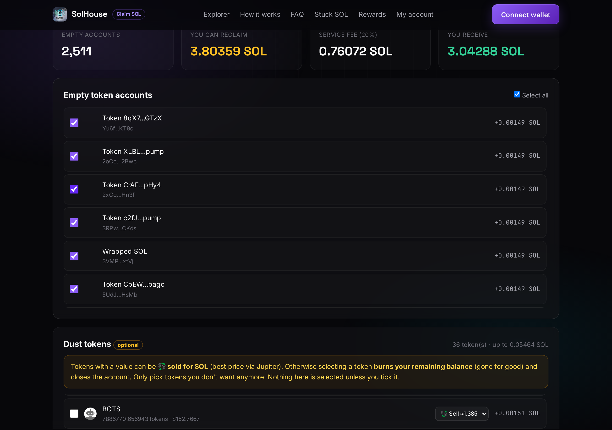
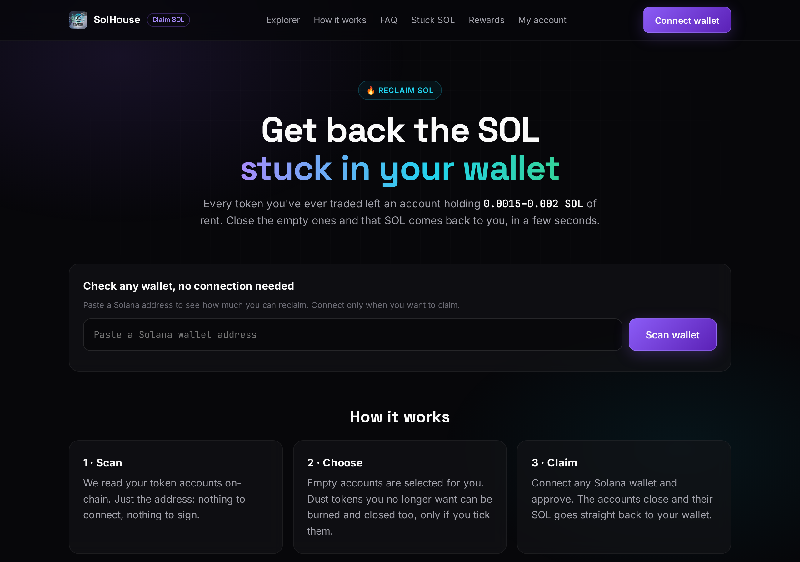

<h1 align="center">Claim SOL</h1>
<p align="center"><i>Your SOL, back in your wallet. Every transaction in plain sight.</i></p>

<p align="center">
  <a href="https://claimsol.solhousesignal.com"></a>
  <a href="LICENSE"></a>
  
  
  
</p>

Every token you trade on Solana opens a token account that locks **~0.002 SOL of rent**. When
you sell, the balance goes to zero but the account stays open, and the SOL stays locked.
Active traders end up with hundreds or thousands of them.

**Claim SOL** finds those empty accounts and closes them: the rent goes straight back to
**your** wallet. This repository is the exact code that builds every transaction users sign
on [claimsol.solhousesignal.com](https://claimsol.solhousesignal.com), published so anyone
can check what they are signing.

<p align="center"></p>

```console
$ python -m examples.test_build_and_cosign
mix: 10 accounts, 691 bytes, signers=1, recovered=20392800 fee=4078560 (20%)
mix: 3 accounts, 418 bytes, signers=1, recovered=6117840 fee=1223568 (20%)
2 closes + 2 burns: 1 transaction, 553 bytes
gas-free co-signed, both signatures valid: True True
gas-free co-signed, both signatures valid: True True
wallet-added Lighthouse guard: accepted
evil transaction refused: transaction was changed
```

---

## What you sign, and nothing else

| Instruction | When | Effect |
|---|---|---|
| ComputeBudget limit and price | always | network priority |
| Token `CloseAccount` (9) | every empty account you select | rent goes to **your** wallet, you are the authority |
| Token `BurnChecked` (15) + `CloseAccount` | only tokens you tick to burn | burns **your own** leftover balance of that token |
| Metaplex `BurnV1` | only NFTs you tick to burn | rent of token, metadata and edition back to you |
| pump.fun `collect_creator_fee` / PumpSwap `collect_coin_creator_fee` | only if you launched tokens and tick "creator fees" | your unclaimed creator fees go to **your** wallet |
| Jupiter swap to SOL + `CloseAccount` | only tokens you tick "Sell" | you get the SOL |
| System `Transfer` to our fee wallet | once per transaction | the service fee, shown before you sign |
| System `Transfer` to the project wallet | gas-free claims only | pays back the small SOL loan we sent you for the network fee, plus the gas-free fee (your wallet stays the only signer) |
| System `Transfer` to your order's payment address | only when you buy VIP on the site | the plan price, a separate transaction you approve |

There are **no** token approvals, no delegations, no `SetAuthority`, and no transfer of your
tokens to anyone. The server re-reads every account from the chain: the browser only says
which of your own accounts to include.

## How it works

| Step | What happens |
|---|---|
| 1. Scan | paste any address: we read its token accounts on-chain. No connection, nothing to sign |
| 2. Choose | empty accounts are pre-selected; dust and NFTs only if you tick them |
| 3. Build | the server builds small transactions (max 850 bytes, Solana allows 1232). Closures and burns share the same transaction, so a small claim needs a single approval |
| 4. Simulate | every transaction is simulated with `sigVerify: false`; any that would fail is dropped before your wallet ever sees it |
| 5. Sign | one transaction per approval, sent with `signAndSendTransaction`: Phantom submits it itself, so its own protections apply |
| 6. Verify | every claim is listed with its on-chain signature in the [public explorer](https://claimsol.solhousesignal.com/explorer/) |

## Gas-free claims

A wallet with 0 SOL can still claim: our project wallet pays the network fee. These
transactions have two signers and follow one strict rule, in
[`claimsol/cosign.py`](claimsol/cosign.py):

1. you sign first;
2. the server adds its signature **only** to a transaction it built for you, and **only**
   after your signature verifies on it;
3. if your wallet changed the transaction before signing (Phantom adds Lighthouse guards),
   it is accepted only when every instruction we built is still there, in order, and the
   only additions are Lighthouse guards or a capped compute budget. An extra transfer, a
   missing instruction or any other program means refusal.

So the project key can never be used to sign anything else. The test above tries to make it
sign a transfer out of the project wallet, and it is refused.

## Files

| File | What |
|---|---|
| [`claimsol/builder.py`](claimsol/builder.py) | close, burn and NFT transactions with the fee transfer |
| [`claimsol/swap.py`](claimsol/swap.py) | "Sell": Jupiter swap, close, fee |
| [`claimsol/nft.py`](claimsol/nft.py) | Metaplex `BurnV1` for junk NFTs |
| [`claimsol/creator.py`](claimsol/creator.py) | pump.fun and PumpSwap creator fee collection |
| [`claimsol/alt.py`](claimsol/alt.py) | lookup tables: up to 25 accounts per transaction, one approval each |
| [`claimsol/simulate.py`](claimsol/simulate.py) | simulation before any signature |
| [`claimsol/cosign.py`](claimsol/cosign.py) | when the server may co-sign a gas-free claim |
| [`web/wallet.js`](web/wallet.js) | browser side: wallet connection and signing, the exact file served by the site |
| [`examples/test_build_and_cosign.py`](examples/test_build_and_cosign.py) | offline check, including a refused tampered transaction |

## Try it

```console
$ pip install solders
$ python -m examples.test_build_and_cosign
```

No network, no keys: it builds a claim for a random wallet, signs it, co-signs it, and shows
that a transaction we did not build is refused.

## Check a real transaction

Open any signature from the [explorer](https://claimsol.solhousesignal.com/explorer/) on
[Solscan](https://solscan.io): you will only find the instructions listed above, the rent
landing in the owner's wallet, and one fee transfer.

<p align="center"></p>

## Contributing

Ideas, new wallets, edge cases, tests: contributions are welcome. Start from
[CONTRIBUTING.md](CONTRIBUTING.md).

## Security

Found something? See [SECURITY.md](SECURITY.md).

## License

MIT. Made by [SolHouse Signal](https://solhousesignal.com).
